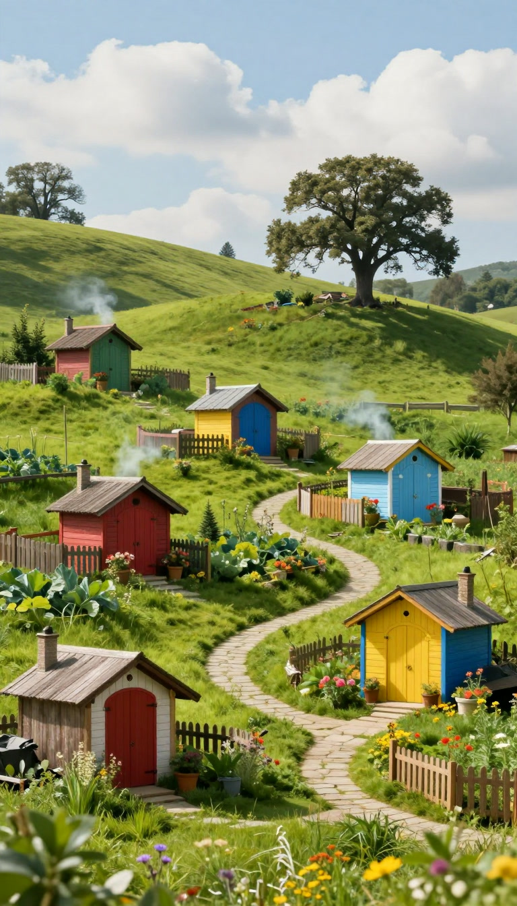

**Türkçe** · [English](README.md) · [Deutsch](README.de.md) · [Français](README.fr.md) · [Español](README.es.md) · [Italiano](README.it.md) · [Português](README.pt.md) · [Русский](README.ru.md) · [Polski](README.pl.md) · [Nederlands](README.nl.md) · [Dansk](README.da.md) · [Norsk](README.nb.md) · [Svenska](README.sv.md) · [Suomi](README.fi.md) · [Ελληνικά](README.el.md) · [العربية](README.ar.md) · [עברית](README.he.md) · [हिन्दी](README.hi.md) · [中文](README.zh.md) · [日本語](README.ja.md) · [한국어](README.ko.md) · [ไทย](README.th.md) · [Tiếng Việt](README.vi.md) · [Bahasa Indonesia](README.id.md) · [Bahasa Melayu](README.ms.md) · [Tagalog](README.tl.md) · [မြန်မာ](README.my.md) · [ខ្មែរ](README.km.md) · [ລາວ](README.lo.md) · [Kiswahili](README.sw.md)

# Sınırsız Foto

**Z-Image-Turbo (Q8_0 GGUF) ile 768x1344 metinden görüntü üretimi: 4 GB'lık GTX 1050 Ti (Pascal, sm_61) üzerinde, stable-diffusion.cpp ile, Windows'ta.** 16 GB RAM'li bir dizüstü bilgisayarda ölçüldü; işlem yaklaşık 11 GB RAM kullanıyor. Aynı tohum aynı pikselleri verir, piksel piksel; ölçümler ve motor yamaları açık, indirmeler sha256 ile sabitlenmiş, bir yapay zekâ kodlama ajanı kurulumu adım adım yapabilir.

*Gayriresmî. Tongyi-MAI (Z-Image), leejet (stable-diffusion.cpp) ya da NVIDIA ile bağlantısı yoktur.*

## Buradan başla

Hazır bir paket var, önce onu dene. Donanımın farklıysa ya da bir adım takılırsa gerisi açık: yamalar, derleme tarifi ve ölçümler bu depoda, kendi kartına göre derleyebilir ya da uyarlayabilirsin.

```
1. nvidia-smi --query-gpu=name,memory.total --format=csv
      expect a line like: NVIDIA GeForce GTX 1050 Ti, 4096 MiB
      NVIDIA card with 4 GB, Windows x64 -> 2        anything else -> 5
2. python scripts/setup.py
      downloads NVIDIA cuDNN by default (NVIDIA's license applies); add --no-cudnn to skip it; both work
      expect the last line: SETUP_OK
3. python scripts/generate.py --prompt-file prompts/eiffel.txt
      expect the last line: IMAGE_OK <path>
4. Open <path>. Done. Compare your numbers: docs/MEASUREMENTS.md
5. Other hardware, or a step failed: everything is open.
      patches/README.md   docs/BUILD.md   docs/MEASUREMENTS.md   docs/TROUBLESHOOTING.md
      Build the engine for your card, or adapt the recipe. AGENTS.md has the exact steps.
```

2. adım yaklaşık 12.2 GB indirir ve bir kez, bizim bağlantımızda 29 dakika sürdü; önce bir "Preflight" bloğu yazdırır (ekran kartın, RAM'in ve boş diskin, ölçtüklerimizin yanında; yalnız bilgi verir).
Yalnız GTX 1050 Ti 4 GB dizüstü kartı (Pascal, hesaplama yeteneği 6.1) ölçüldü. Öteki kartlar denenmedi.
Bir yapay zekâ kodlama ajanı kullanıyorsan (Claude Code, Codex, Cursor ve benzerleri) onu [`AGENTS.md`](AGENTS.md) dosyasına yönlendir.

## Bir bakışta

v0.1.0 düzenine göre: bir resim 261.6 s yerine 193–228 s sürüyor, VAE aşaması 29.8 ile 36.3 s yerine 8.3–15.9 s sürüyor, aynı tohum aynı pikselleri veriyor ve bu README'deki her sayının arkasında bir komut ve bir dosya var.

768x1344, tohum 42, 8 adım, aynı makine. v0.1.0 sayıları v0.1.0 README'sinden (temiz kök testi ve beş koşu); v0.2.0 sayıları bu sürümün temiz kök testinden.

| | v0.1.0 (yayımlanmadı; eski düzen) | v0.2.0 |
|---|---|---|
| Bir resim için süre (bir `generate.py` koşusu) | 261.6 s | 193–228 s |
| VAE çözme (son aşama) | 29.8 ile 36.3 s | 8.3–15.9 s |
| Referans çözüme yakınlık (PSNR, yüksek olan daha yakın) | 38 ile 43 dB | 71 ile 73 dB |
| GPU belleği tepesi (nvidia-smi) | 2949 ile 2957 MiB | 3057–3059 MiB |
| İşlem belleği, tepe | 10.5 ile 10.9 GB (o zaman kaydedildiği gibi) | 10 667–10 915 MiB |
| Görülen en düşük boş RAM | 331 ile 576 MiB | 418–545 MiB |

Nasıl okunur: referans, aynı latent'in CPU'da tek parça float32 olarak çözülmüş hâlidir; PSNR bizim GPU çözümümüzü onunla karşılaştırır (3 resim). VAE aşamasının bu referansa ne kadar yakın olduğunu söyler. Bir resmin güzel olup olmadığını söylemez. v0.2.0 resimleri, aynı istem ve tohum için v0.1.0 ile bayt bayt aynı değildir, çünkü VAE yolu bilerek değişti. Yöntem ve ölçülmeyenler: [`docs/MEASUREMENTS.md`](docs/MEASUREMENTS.md).

## Örnekler

**Bu depoyla üretilmiş yapay zekâ görüntüleri** (Z-Image-Turbo Q8_0, tohum 42, 8 adım). Bunlar gerçek fotoğraf değildir; yapılar ve ayrıntılar
yanlış olabilir ve bir resim her ayrıntıda istemi izlemeyebilir. Tam istemler [`prompts/`](prompts) ve [`docs/PROMPTS.md`](docs/PROMPTS.md) içinde.

| | | |
|---|---|---|
|  |  |  |
| `prompts/eiffel.txt`, 768x1344 | `prompts/turkish_tea.txt`, 768x1344 | `prompts/fisherman.txt`, 768x1344 |
|  | | |
| `prompts/village.txt`, 768x1344 | | |


`prompts/istanbul_aerial.txt`, 1344x768. Gerçek fotoğraf değil; yapılar yanlış olabilir.

## Hızlı kurulum

Gereksinimler: Windows 10/11, 4 GB'lık bir NVIDIA ekran kartı, CUDA 12.8'i destekleyen bir sürücü (sürücü 581.29 ile ölçüldü; daha eski sürücüler denenmedi; CUDA çalışma zamanının kendisi senin için indirilir), Python 3.10 ya da üstü,
git, yaklaşık 14 GB boş disk (indirmeler cuDNN ile yaklaşık 12.2 GB; boş disk rakamı bir tahmindir) ve 16 GB RAM (ölçülen bu; daha azı denenmedi).

```powershell
git clone https://github.com/alexturkey/z-image-turbo-pascal-4gb.git
cd z-image-turbo-pascal-4gb
python scripts/setup.py
python scripts/generate.py --prompt-file prompts/eiffel.txt
```

- `setup.py` önce bir "Preflight" bloğu yazdırır (ekran kartın, RAM'in ve boş diskin, ölçtüklerimizin yanında; yalnız bilgi verir, hiçbir şeyi engellemez). Sonra [`models.lock.json`](models.lock.json) içindeki sabit adreslerden indirir ve her dosyayı sha256 ile denetler. `MODEL_OK <name>`, `ENGINE_OK`, `CUDART_OK`, ardından `CUDNN_OK` ya da `CUDNN_SKIPPED` ve en sonda `SETUP_OK` yazdırır.
  `--models-dir` ve `--bin-dir` verilmezse deponun kök klasöründeki `models/` ve `bin/` kullanılır; modelleri bir SSD'ye koy (yalnız SSD ile ölçüldü).
  Ctrl+C ile istediğin an durdur, aynı komutu yeniden çalıştır: indirmeler `.part` dosyalarından devam eder.
- **cuDNN varsayılan olarak kurulur ve bu deponun parçası değildir.** NVIDIA'nın kendi lisansı altındaki NVIDIA yazılımıdır ve NVIDIA ekran kartlı sistemler içindir ([lisans metni](https://docs.nvidia.com/deeplearning/cudnn/backend/latest/reference/eula.html)). NVIDIA'nın sunucusundan ödeme istenmeden ve oturum açmadan iner; lisansta ticari ya da kişisel kullanımı sınırlayan bir madde bulamadık. `setup.py` lisans adresini yazar, dosyayı indirir ve yalnız sekiz DLL'yi `sd-cli.exe`'nin yanına kopyalar. NVIDIA'nın lisansı, koşullarını kabul etmeyen kimsenin onu indirmemesi, kurmaması ve kullanmaması gerektiğini söyler; bu durumda `python scripts/setup.py --no-cudnn` çalıştır. cuDNN olmadan da her şey, daha yavaş olan v0.1.0 VAE yoluyla (`--vae legacy`) çalışır ve `generate.py` bunu söyler.
- `generate.py`, `outputs/<YYYYmmdd_HHMMSS>_<name>/image.png`, `run.json` (süre, aşamalar, hangi VAE yolunun çalıştığı, GPU belleği tepesi, tam komut) ve `log.txt` yazar ve `IMAGE_OK <path>` yazdırır.

## Kullanım

```powershell
python scripts/generate.py --prompt "A lighthouse on a cliff at dawn, realistic photograph"
python scripts/generate.py --prompt-file prompts/eiffel.txt --width 1344 --height 768 --seed 7 --vae auto
```

| Seçenek | Anlamı |
|---|---|
| `--prompt "<text>"` ya da `--prompt-file <txt>` | istem (ikisinden biri gerekli) |
| `--width`, `--height` | 16'nın katları, 256 ile 2048 arası; varsayılan 768x1344; denenenler: 768x1344, 1344x768, 1024x1024 |
| `--seed` | varsayılan 42 |
| `--out`, `--name` | çıktı klasörünün kökü (varsayılan `outputs/`) ve koşu klasörü için kısa bir ad |
| `--models-dir`, `--bin-dir` | `setup.py`'nin modelleri ve motoru koyduğu yerler |
| `--vae auto` (varsayılan) | cuDNN float32; önce tek parça, sonra iki büyük karo, sonra küçük varsayılan karo |
| `--vae tiled` | cuDNN float32, her zaman iki büyük karo |
| `--vae legacy` | v0.1.0 yolu: cuDNN yok, küçük karolar. cuDNN DLL'leri yoksa kendiliğinden (bir uyarıyla) kullanılır |

Adımlar (8), cfg (1.0), örnekleyici ve zamanlayıcı bilerek sabittir; bkz. [Ne çalıştırır](#what-it-runs).

## Kendin doğrula

- `generate.py`, son satırlarından biri olarak `PIXEL_SHA256 <hex>` yazdırır: çözülmüş piksellerin özeti. Aynı komutu iki kez çalıştır ve iki resmi karşılaştır: `python scripts/compare.py <run A>/image.png <run B>/image.png` komutu `SAME_PIXELS` yazdırmalı.
- Beş örneğin `PIXEL_SHA256` değeri bizim makinemizde [`docs/MEASUREMENTS.md`](docs/MEASUREMENTS.md) içinde. Bir PNG'nin dosya özeti, pikseller aynı olsa bile farklı çıkabilir, çünkü PNG üretim parametrelerini metin olarak taşır; dosyaları değil pikselleri karşılaştır.
- Dürüst sınır: başka bir kartın ya da sürücünün aynı pikselleri verip vermediğini ölçmedik.

## 4 GB'a neden sığıyor

- **Model yazarları ne diyor.** Z-Image-Turbo model kartı, modelin "fits comfortably within 16G VRAM consumer devices" (16 GB'lık tüketici kartlarına rahatça sığar) dediğini yazıyor ([model kartı](https://huggingface.co/Tongyi-MAI/Z-Image-Turbo)). Bu, 16 GB'lık kartlar hakkında bir ifadedir. Resmî README ayrıca stable-diffusion.cpp'yi üçüncü taraf bir seçenek olarak listeliyor ve onu "as little as 4GB of VRAM" (en az 4 GB VRAM'le) diye aktarıyor ([README](https://github.com/Tongyi-MAI/Z-Image)); bu, stable-diffusion.cpp projesinin iddiasıdır, Z-Image ekibinin bir şartı değil.
- **Biz ne ölçtük.** Z-Image-Turbo Q8_0 (6.6 GB'lık bir dosya) ve Qwen3-4B Q8_0 metin kodlayıcı, 768x1344: nvidia-smi'nin her 2 s'de bir örneklediği GPU tepesi (kısa bir sıçrama kaçabilir), 4096 MiB'lık kartta 2949 ile 2957 MiB (v0.1.0 motoru) ve 3057–3059 MiB (v0.2.0 motoru) oldu. Ağırlıklar (10 509 MiB; motor günlüğü bunu MB diye yazdırır) sistem RAM'inde kalır; motor ağı GPU'ya her seferinde bir parça (ağın bir dilimi) kopyalar: 36 parça, günlük satırındaki gibi `z_image using 36 segments`.
- **Bedeli ne.** Zaman ve sistem belleği: resim başına 193–228 s ve motor işlemi 16 GB'lık makinede yaklaşık 10 667–10 915 MiB RAM tutar (bellek eşlemeli model sayfaları dahil); bu yüzden çalışırken boş RAM birkaç yüz MiB'a düşer.
- **Başkalarının kurulumları.** Başkaları Z-Image'i 4 GB'lık kartlarda daha düşük nicemleme ya da daha küçük boyutlarla çalıştırdığını bildiriyor (örneğin 4 GB'lık kartlar için stable-diffusion.cpp wiki sayfası 1024x512'de Q3_K ya da Q4_0 öneriyor). Baktığımız yerlerde ([`docs/RELATED.md`](docs/RELATED.md) içinde liste ve tarih) dördünü birden birleştiren yayımlanmış bir kurulum bulamadık: 4 GB'lık kart, Q8_0, 768x1344 ya da daha büyük ve ölçülmüş süre ile GPU belleği. Bu, baktığımız yerler hakkında bir ifadedir, her yer hakkında değil.
- **Kim ne yapıyor.** 4 GB'a sığmayı stable-diffusion.cpp'nin kendisi sağlar: `--offload-to-cpu`, `--mmap`, dilim dilim çalışma ve flash attention (kapalıyken bir koşu 4205 MB istedi ve sığmadı). Yamalarımız hız ve daha iyi bir VAE aşaması içindir, sığmak için değil. Yamasız ana motoru bu kartta çalıştırmadık, o yüzden sığıp sığmadığını söyleyemeyiz.

## Nasıl çalışıyor

stable-diffusion.cpp `master-1088-32d516c` üzerine üç değişiklik (hepsi birer anahtardır; [`patches/README.md`](patches/README.md) içindeki tablo her birini ortam değişkeniyle listeler):

1. **İyileştirici (refiner) adım başına bir kez çalışır.** Bir grup adı iki kez kullanıldığı için dört iyileştirici blok ikinci kez hesaplanıyordu. Düzeltince 2 ile 8. adımlar her biri yaklaşık 1.3 s hızlandı (22.0 s'den 20.7 s'ye), resim piksel piksel aynı (3 resim denetlendi).
2. **VAE, cuDNN ile, float32'de.** Son aşama (latent'i piksele çevirmek) artık NVIDIA'nın cuDNN float32 evrişimini kullanıyor. Bizim kartta VAE'yi 23 ile 27 s'den 10 ile 15 s'ye indirdi ve referansa PSNR'ı 38 ile 43 dB'den 45 ile 49 dB'ye çıkardı (büyük karolarla).
3. **Önce tek parça.** Motor artık bellek denetimi sığıyor derse (pay 256 MiB) resmin tamamını tek parça çözmeyi dener, olmazsa iki büyük karoya, sonra küçük karolara düşer. Tek parçada VAE yaklaşık 8–16 s sürdü ve referansa PSNR 71 ile 73 dB oldu. Zorlanmış bir geri düşüş olursa resim karolu olanla aynı piksellere sahiptir (`PIXEL_SHA256` ile denetlendi). Olan şey `run.json` içine yazılır (`stages.vae_path`: `full`, `tile`, `floor` ya da `retry`).

Ayrıca: `--eager-load` (model sayfalarını baştan okur; aynı resimde 241.2 s'den 220.3 s'ye, geliştirme sürümü, her biri bir koşu) sabit komutun parçasıdır.

<a id="what-it-runs"></a>
## Ne çalıştırır

| Parça | Dosya | Kaynak |
|---|---|---|
| Difüzyon modeli | `z_image_turbo-Q8_0.gguf` (6,577,440,704 B) | [leejet/Z-Image-Turbo-GGUF](https://huggingface.co/leejet/Z-Image-Turbo-GGUF), temel model [Tongyi-MAI/Z-Image-Turbo](https://huggingface.co/Tongyi-MAI/Z-Image-Turbo) |
| Metin kodlayıcı | `Qwen3-4B-Instruct-2507-Q8_0.gguf` (4,280,405,600 B) | [unsloth/Qwen3-4B-Instruct-2507-GGUF](https://huggingface.co/unsloth/Qwen3-4B-Instruct-2507-GGUF) |
| VAE | `ae.safetensors` (335,304,388 B) | [Comfy-Org/Z-Image-Turbo](https://huggingface.co/Comfy-Org/Z-Image-Turbo), FLUX.1 tipi otomatik kodlayıcı |
| Motor | `sd-cli.exe`, stable-diffusion.cpp `32d516c` ve [`patches/`](patches) içindeki yamalar | bu deponun v0.2.0 sürümü (`sinirsiz-foto-engine-v0.2.0-win-x64-cuda12.8-sm61.zip`) |
| CUDA çalışma zamanı | `cudart`, `cublas`, `cublasLt` (12.8), değiştirilmemiş | wan22-pascal-4gb v0.1.0 sürümündeki zip |
| cuDNN (varsayılan olarak kurulur; `--no-cudnn` atlar) | 8 DLL, sürüm 9.10.2.21 (CUDA 11 derlemesi) | NVIDIA'nın kendi sunucusu, NVIDIA'nın lisansı altında; burada saklanmaz |

Sabit ayarlar: `--cfg-scale 1.0 --steps 8 --sampling-method euler --scheduler simple --offload-to-cpu --mmap --eager-load --flash-attn on`.
Adımları düşürmeyiz, olumsuz istem eklemeyiz, önbelleği açmayız: model 8 adım için damıtılmıştır ve olumsuz istem kullanmaz (bkz. [istemler](docs/PROMPTS.md)).

## Sınırlar (güvenmeden önce oku)

- **Yalnız Windows.** Hazır motor ve bu betikler yalnız Windows içindir.
- **Bir kart, bir makine.** Yalnız bir GTX 1050 Ti 4 GB dizüstünde ölçüldü (i7-7700HQ, 16 GB RAM, Windows 10, sürücü 581.29, modeller SSD'de). Öteki GPU'lar ve sürücüler, 16 GB'tan az RAM'li makineler, Linux ve macOS: **denenmedi**.
- Diğer kartlar ve sistemler (hangi yol var ve kendimiz çalıştırmadığımız, Linux'ta bir AMD kartla yapılmış topluluk testi): [docs/OTHER_GPUS.md](docs/OTHER_GPUS.md).
- **Motor yalnız Pascal (sm_61) için derlendi.** Öteki mimariler kendi derlemeni ister ([`docs/BUILD.md`](docs/BUILD.md)); birini denemedik.
- **cuDNN:** cuDNN 9.10.2.21'in CUDA 11 derlemesiyle ölçtük. CUDA 12 derlemesinin dosyaları farklıdır ve ölçülmedi.
- **Bellek dar.** Boş RAM birkaç yüz MiB'a düşer; öteki programları kapat, her seferinde bir resim üret. Motorun bellek denetimi geçtikten sonra GPU belleğinin bittiğini görmedik ve o durumda ne olduğunu denemedik.
- **Boyutlar:** yalnız 768x1344, 1344x768 ve 1024x1024 denendi. Daha büyük boyutlar bir uyarı yazdırır ve belleği aşabilir.
- İstemle uyum kısmidir: bir resim her ayrıntıda istemi izlemeyebilir. Resim içindeki yazı ve gerçek dünyadaki yapılar değerlendirilmedi.
- PSNR referansı kendi motorumuzun CPU çözümüdür, bağımsız bir uygulama değil.
- [`docs/MEASUREMENTS.md`](docs/MEASUREMENTS.md) içindeki sayılar, aksi yazılmadıkça birer koşudan gelir.

## Lisans ve atıf

- Bu deponun betikleri ve belgeleri: [Apache-2.0](LICENSE), yanında bir [`NOTICE`](NOTICE) dosyası. [`patches/`](patches) içindeki motor yamaları, değiştirdikleri kod gibi MIT'tir.
- stable-diffusion.cpp ve ggml MIT'tir. Motora derlenen üçüncü taraf kodun bildirimleri [`licenses/`](licenses) ve [`THIRD_PARTY.md`](THIRD_PARTY.md) içindedir.
- Model dosyaları burada saklanmaz; yukarıdaki kaynaklardan, kendi lisansları altında indirilir (Hugging Face hepsi için Apache-2.0 gösteriyor, 2026-11-13 tarihinde okundu). Model kartı üretilen resimlerin kime ait olduğu hakkında bir şey söylemiyor ve biz de bu konuda bir iddiada bulunmuyoruz.
- **cuDNN ve CUDA çalışma zamanı NVIDIA'nın malıdır** ve bu deponun lisansı altında değildir. cuDNN, NVIDIA'nın sunucusundan NVIDIA'nın lisansı altında indirilir (`--no-cudnn` atlar); CUDA çalışma zamanı DLL'leri ayrı, değiştirilmemiş bir zip içindedir (CUDA Toolkit EULA, Ek A). Ayrıntılar ve doğrulayamadıklarımız: [`THIRD_PARTY.md`](THIRD_PARTY.md).
- **Atıf.** `NOTICE` dosyasını kopyalarla ve türev işlerle birlikte korumak koşuldur (Apache-2.0, madde 4). Ötesinde, "Based on Sınırsız Foto by Ali Haydar Öztürk (Ozturk), https://github.com/alexturkey" gibi bir satır memnuniyetle karşılanır, zorunlu değildir.
- Lütfen [`ETHICS.md`](ETHICS.md) dosyasını oku: her resim yapaydır ve yayımladığından sen sorumlusun.

## Katkı

Yapabileceğin en işe yarar şey **kartını test etmek** ve ne olduğunu bize yazmak: ekran kartı adı, sürücü, RAM, `run.json` ve günlüğün son satırları ("Hardware test report" sorun formu). Belgelerde ve betiklerde düzeltmeler de hoş karşılanır; bkz. [`CONTRIBUTING.md`](CONTRIBUTING.md). Güvenlik bildirimleri [`SECURITY.md`](SECURITY.md) içindeki özel yoldan gider.

[Yapay zekâ ajanları için kurulum kılavuzu](AGENTS.md) · [Ölçümler](docs/MEASUREMENTS.md) · [Sorun giderme](docs/TROUBLESHOOTING.md) · [Motoru derleme](docs/BUILD.md) · [Yamalar](patches/README.md) · [İstemler](docs/PROMPTS.md) · [Üçüncü taraf](THIRD_PARTY.md) · [Değişiklik günlüğü](CHANGELOG.md)
